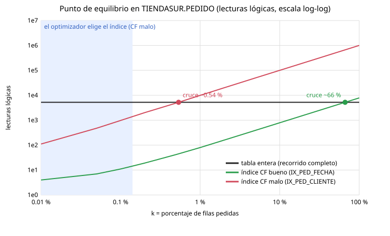

# Lab 5 · Oracle DBA Workflow II — Respuestas

Rutas de evidencia relativas a `docs/bitacora/lab5/evidencia/`. Todas las ejecuciones son del 2026-10-26 y las horas están en UTC. Las lecturas lógicas se miden en caliente (segunda ejecución) con `lab_tools.medir`.

## Diferencias de mi entorno respecto al enunciado

- **La base ya estaba en ARCHIVELOG** desde antes del Lab 4, pero **sin FRA**: los archivados iban a `$ORACLE_HOME/dbs/arch` (`arch1_<seq>_<resetlogs>.dbf`). `11-activar-archivelog.sh` no tuvo que reiniciar la base. Solo fijó la FRA, y desde ese momento los archivados salen con nombre OMF (`o1_mf_1_15_…arc`) en `fra/FREE/archivelog/2026_10_26/` (`script/20261026T145415Z_11-activar-archivelog.script.log`). Por eso **ya había procesos ARC0-ARC3 en el Lab 4**.
- **Redo de 200 MB y 3 grupos** (el enunciado tiene 2 grupos de 20 MB). Consecuencias: solo hay 19 cambios de log en la hora del laboratorio (no 69). Y el tercer borrado de la Parte K da `ORA-00350` en vez de `ORA-01567`: con 3 grupos, borrar uno no deja menos de 2, y lo que lo impide es que aún no está archivado.
- **Mis cifras de TiendaSur**: CLIENTE ocupa 1517 bloques con R = 102 y bfr 66 (en el enunciado, 1467, 98 y 68). PEDIDO coincide: 5320 bloques, R = 32 y bfr 188. El datafile de TBS_ACADEMIA es el **16** (no el 25).
- **Simulacro D**: me tocó el camino con **ORA-63999** (Oracle cerró FREEPDB1).
- Antes de empezar cerré el Lab 4 (partes L-O, PR #6). Esta rama sale de ese estado.

---

## Puntos de control y retos

### Parte A
La copia `lab4-final` tardó **2 min 3 s** y ocupa **553 MB** (`backups/20261026T143608Z_lab4-final`, evidencia `script/20261026T143608Z_00-backup-lab4.script.log`). En el **paso 6**: «ninguno: el volumen contiene toda la base de datos». Comparación con la copia del Lab 3 en la pregunta 1.

### Parte B
**Perfil** (`script/20261026T143857Z_01-perfil-tiendasur.script.log`): CLIENTE con 100 000 filas, 1517 bloques, R = 102 y bfr = 66; PEDIDO con 1 000 000 filas, 5320 bloques, R = 32 y bfr = 188. Sesgos: pais = ES 60,1 %, Lorca 0,1 %, `Gonz%` 2,1 %, estado P 2 %, último año 33,3 %. Estados: C 90,2 %, E 5 %, D 2,8 %, P 2 %. La herramienta de medida da `prueba_pk` = 4 lecturas.

**Reto — bfr de PEDIDO a mano** (`scripts/lab5/01-reto-bfr-pedido.sql`, `script/20261026T144007Z_01-reto-bfr-pedido.script.log`):

| Tabla | NUM_ROWS / BLOCKS | Bloques con filas | Mín · media · máx de filas por bloque |
| --- | --- | --- | --- |
| PEDIDO | 1 000 000 / 5320 = **188** | 5220 | 2 · **191,6** · 200 |
| CLIENTE | 100 000 / 1517 = **65,9** | 1477 | 22 · **67,7** · 71 |

En PEDIDO, 2301 bloques tienen 191 filas, 2867 tienen 192, 51 entre 196 y 200, y el último tiene 2. No todos tienen las mismas filas porque las filas miden entre 21 y 26 bytes de datos: los importes tienen más o menos cifras y los códigos postales más o menos caracteres. El bloque se cierra cuando la siguiente fila ya no cabe respetando PCTFREE 10. El último bloque está casi vacío porque ahí se acabaron los datos. Además, `BLOCKS` cuenta 100 bloques sin filas bajo la HWM (cabecera del segmento y mapas de bits de ASSM), así que la media de las estadísticas (188) es menor que la real de los bloques con datos (191,6).

### Parte C
**Anatomía** (`script/20261026T144047Z_02-anatomia-indice.script.log`, traza `config/20261026T144047Z_02-volcado-indice.trc.txt`): ver preguntas 4 y 5. La búsqueda `id_pedido = 4711` cuesta **4 buffers** (3 de PK_PEDIDO + 1 de la tabla) y **3** si solo se pide la clave. Gráficos: PK_PEDIDO con 1875 hojas al 99,9 % y mapa `[####…]`; IX_PED_CLIENTE con 2216 hojas al 89,7 % y mapa `[====…]`.

**Reto — calcula antes de medir: UX_CLI_EMAIL** (`scripts/lab5/02-reto-ux-cli-email.sql`, `script/20261026T144115Z_02-reto-ux-cli-email.script.log`):
1. A mano, con 30 bytes por entrada y PCTFREE 10: ⌊7996 · 0,9 / 30⌋ = 239 entradas por hoja → ⌈100 000 / 239⌉ = 419 hojas → altura = 1 + ⌈log₅₄₃ 419⌉ = **2**.
2. Medido (`VALIDATE STRUCTURE`): **altura 3**, 501 hojas, 3 ramas, 35,9 bytes por entrada de hoja (no 30) y 18,2 por entrada de rama. El fo máximo de este índice es 8028 / 18,2 = **442**, no 543: las claves de rama de un email son más largas que un número. Con 501 hojas > 442 entradas por bloque de rama, ya no caben todas en la raíz y hace falta un nivel más. Fallé por las dos suposiciones: entradas más largas → más hojas; claves de rama más largas → menos fo.
3. Gráficos (`script/20261026T144115Z_02-reto-grafico-UX_CLI_EMAIL.script.log` y `…PK_CLIENTE…`): UX_CLI_EMAIL tiene 501 hojas al **89,6 %** (200 entradas por hoja, mapa `[====…]`); PK_CLIENTE tiene 187 hojas al **99,6 %** (535 por hoja, mapa `[####…-]`). La diferencia está en **cómo y en qué orden llegaron las claves**. PK_CLIENTE ya existía durante la carga (V004 la declara en el `CREATE TABLE`) y recibió las claves en orden creciente: divisiones 90/10 y hojas llenas. UX_CLI_EMAIL se creó **después** con `CREATE INDEX`, que ordena todas las claves y llena cada hoja hasta el 90 % (PCTFREE 10 por defecto). Además, cada entrada ocupa más del doble (email frente a número).

### Parte D
**Experimentos** (`script/20261026T144139Z_03-tipos-indice.script.log`): resumen en la pregunta 6.

**Reto — el índice cubriente para Q9** (`scripts/lab5/03-reto-cubriente-q9.sql`, `script/20261026T144251Z_03-reto-cubriente-q9.script.log`): Q9 hoy cuesta **5 lecturas** con IX_PED_FECHA; con un índice cubriente de prueba (fecha + todas las columnas), 3.
**Decisión: no lo pediría.** Ahorra 2 lecturas por ejecución, pero el índice ocupa **49 MB**, más que la propia tabla (42 MB) y el doble que IX_PED_FECHA (22 MB), y encarecería cada INSERT y cada UPDATE de cualquier columna.

### Parte E
**CF y curva** (`script/20261026T144257Z_04-agrupamiento-equilibrio.script.log`): PK_PEDIDO e IX_PED_FECHA tienen CF **5220** (≈ 5320 bloques); IX_PED_CLIENTE **999 041** e IX_PED_IMPORTE **998 078** (≈ 1 000 000 filas). El cálculo a mano coincide exactamente con el diccionario.

**Reto — dibuja tu curva** (`scripts/lab5/04-reto-curva.sh` genera el SVG desde la evidencia; `script/20261026T144528Z_04-reto-curva.script.log`):



El índice con CF malo cruza la tabla en **~0,54 %**, el de CF bueno en **~66 %**, y el optimizador deja de elegir el índice malo entre el **0,1 % y el 0,2 %**. No coinciden porque miden cosas distintas:
- Mis curvas cuentan lecturas lógicas, que cuestan todas igual.
- El optimizador supone que una lectura aleatoria cuesta más que una secuencial (c_sec / c_aleat ≈ 1/5 → umbral 0,11 %), así que abandona el índice antes.
- Con CF bueno, el índice lee unos k/bfr bloques en orden y compensa casi hasta el final.

### Parte F
**Las cinco reglas** (`script/20261026T144541Z_05-sargabilidad.script.log`), lecturas antes → después:

| Regla | Consulta | Rota | Reescrita |
| --- | --- | --- | --- |
| 1 Función | Q1 `UPPER(email)` → `email = LOWER(:e)` | 1486 (FULL) | 4 (UNIQUE SCAN) |
| 2 Aritmética | Q2 `fecha + 30 >= …` → `fecha >= … - 30` | 5284 | 320 |
| 3 Conversión implícita | Q3 `codigo_postal = 30001` → `'30001'` | 5232 (`TO_NUMBER("CODIGO_POSTAL")`) | 106 |
| 4 Comodín | Q4a `LIKE '%ez'` / Q4b `LIKE 'Gonz%'` | 1523 (FULL) | 2024 (usa índice, pero pierde: pregunta 9) |
| 5 OR | Q5 email OR teléfono | 1486 (FULL) | 6 (BITMAP OR) / 6 (UNION) con índice en las dos ramas |

Bonus Q11: 5232 → 5232. La versión con rango es sargable, pero un año es un tercio de los pedidos y el recorrido completo es lo correcto (72,8 → 34,4 ms).

**Reto — revisión de código** (`scripts/lab5/05-reto-revision.sql`, `script/20261026T144822Z_05-reto-revision.script.log`). Comentario que dejaría en el PR:

> **issue (blocking):** `WHERE SUBSTR(telefono, 1, 3) = '600' OR UPPER(apellidos) = 'GIL'` rompe dos reglas. La 1 dos veces: `SUBSTR` y `UPPER` sobre columnas. Y la 5: un `OR` necesita índice en cada rama. Hoy hace TABLE ACCESS FULL CLIENTE con **1487 lecturas**. Además, la rama de apellidos **nunca devuelve nada**: `apellidos` guarda los dos apellidos con mayúscula inicial ("García Cortés"), y `UPPER(apellidos) = 'GIL'` da 0 filas.
> Propuesta: `WHERE telefono LIKE '600%' OR apellidos LIKE 'Gil %'`. Es sargable, busca el primer apellido y devuelve las mismas 981 filas. Con índices en `telefono` y `apellidos` baja a **722 lecturas** (BITMAP OR); como `UNION`, 986.
> **suggestion:** son 981 clientes (~1 %) con CF malo, cerca del punto de equilibrio. El índice solo reduce la lectura a la mitad. Antes de crear dos índices para este panel, confirmaría su frecuencia y si de verdad se buscan todos los teléfonos que empiezan por 600 o un teléfono concreto (que sería 1 fila y 4-6 lecturas).

### Parte G
**Protocolo** (`script/20261026T144835Z_06-indices.script.log`): ver pregunta 10 y la cabecera de `database/migrations/V005__indices_tiendasur.sql`. A esa cabecera le añadí solo comentarios con mis cifras; V005 es nueva en esta rama.

**Reto — defiende tu propio índice: V006 `IX_CLI_TELEFONO` para Q5** (`scripts/lab5/06-reto-v006.sql`, `script/20261026T145027Z_06-reto-v006.script.log`; migración en la rama `feat/7-v006-ix-cli-telefono`, PR en borrador #8 contra la rama del Lab 5, **sin fusionar**):
1. Necesidad: Q5 (identificar a quien llama por email o teléfono) hace FULL CLIENTE con **1486** lecturas.
2. Viabilidad: 100 000 teléfonos distintos, 0,001 % por valor. Con el índice, **6** lecturas.
3. Escritura: INSERT en CLIENTE de **10,2 → 12,1** bloques por fila y de 1445 → 1640 bytes de redo.
4. Redundancia: ningún índice de CLIENTE empieza por TELEFONO. Ocupa 294 hojas y 3 MB.
5. Ciclo de vida: `ONLINE`, revisión con `DBA_INDEX_USAGE` al mes e `INVISIBLE` antes de cualquier `DROP`.

Conclusión: **compensa**. CLIENTE recibe pocas altas comparado con los 300 INSERT/s de PEDIDO, y Q5 es interactiva. La descripción del PR está en el propio PR #8.

**Precio a vigilar de V005** (mío, no del enunciado): el UPDATE de `estado` pasa de **2 a 8,1** bloques por fila porque `estado` está en el cubriente y en el parcial. Con 150 UPDATE de estado por segundo, son unos 900 bloques más por segundo. Si eso pesara, quitaría `estado` del cubriente (Q7 iría a la tabla para esa columna).

### Parte H
**Divisiones, cola y remedios** (`script/20261026T145118Z_07*`): ver preguntas 11 y 12.

| Índice | Divisiones (90/10) | Hojas | Llenado |
| --- | --- | --- | --- |
| IX_AZAR | 595 (0) | 596 | 75,4 % (14 hojas bajo el 50 %) |
| IX_CRECIENTE | 398 (398) | 399 | 99,9 % |
| IX_INVERTIDA | 511 (0) | 512 | 77,9 % |

El precio del REVERSE: un rango que cuesta **4** lecturas con el índice normal cuesta **878** (FULL) con el invertido. IX_AZAR queda al 75 %, algo por encima del 69 % (ln 2) de la teoría, porque la tabla aún está creciendo y las hojas recientes no se han dividido.

**Reto — diagnostica sin ver el script:** depende de un índice degradado que crea el profesor en clase. Cuando exista, aplicaré `grafico-indice.sh` + `INDEX_STATS` y dejaré el diagnóstico como comentario en el Issue #7. Criterio: sano = mapa uniforme; fragmentado (50/50) = 60-80 % disperso; cola = izquierda vacía con `DEL_LF_ROWS` alto.

**Punto de control antes de la durabilidad**, con una cifra de mi evidencia cada una:
- La PK cuesta 4 lecturas: 3 niveles de PK_PEDIDO + 1 bloque de tabla.
- IX_PED_CLIENTE pierde al 1 %: 9920 lecturas frente a 5232 de la tabla, porque CF = 999 041.
- Q3 no usaba el índice: `TO_NUMBER("CODIGO_POSTAL")=30001`.
- Cada índice añade unos 2 bloques por INSERT: 10,2 con 4 índices, 20,2 con 9 y 12,4 con 5.
- La cola leía **226** bloques para una fila: 224 hojas vacías a la izquierda.

### Parte I
**SCN y checkpoint** (`script/20261026T145228Z_08-scn-checkpoint.script.log`):
- SCN 5 207 175 → 5 207 177 en 3 s sin hacer nada.
- Checkpoint en el control file: 5 201 180, igual en las cabeceras.
- Tras el UPDATE y `ALTER SYSTEM CHECKPOINT`: **5 207 182** en todos los archivos abiertos (system, sysaux, academia01 = file 16).
- **PDB$SEED no**: sigue en **2 098 101** porque está en READ ONLY. Nadie la modifica, así que no tiene bloques sucios y su checkpoint no avanza.
- `ACTUAL_REDO_BLKS` = **476 036** bloques de 512 bytes (~232 MB) y `ESTIMATED_MTTR` = **33 s**. Ese redo viene de las Partes B-H (carga de TiendaSur, 200 000 inserciones de la Parte H, mediciones DML). La vista se refresca con retraso: en el reto, justo tras un checkpoint, ya marca 6.
- Con una carga diez veces mayor crecería el redo pendiente y con él el MTTR. Lo acota `FAST_START_MTTR_TARGET` (aquí 0, desactivado; solo actúa `log_checkpoint_timeout` = 1800 s): fijándolo, Oracle adelanta checkpoints incrementales para no superarlo.

**Reto — el MTTR bajo carga** (`scripts/lab5/08-reto-mttr.sql`, `script/20261026T145254Z_08-reto-mttr.script.log`): tras el checkpoint, 6 bloques de redo pendientes y 3 E/S estimadas. Tras un UPDATE de 20 000 filas + COMMIT, **13 067** bloques y **526** E/S. Tras el segundo, **16 741** y **638**. `ESTIMATED_MTTR` se quedó en 33 s porque Oracle lo recalcula cada cierto tiempo y tiene un mínimo fijo (arrancar y leer el control file). **Cuanto más redo queda sin cubrir por un checkpoint, más bloques hay que rehacer al arrancar: el tiempo de recuperación crece con el redo pendiente.**

### Parte J
**Control file** (`script/20261026T145316Z_09-controlfiles-info.script.log`): 2 copias de 1146 bloques de 16 KB (18 MB). Secciones con más registros: STANDBY DATABASE MATRIX 128, OFFLINE RANGE 57, DATAFILE 26, FILENAME 26, TABLESPACE 23, LOG HISTORY 12 y **ARCHIVED LOG 12**. Esta última aparece porque estoy en ARCHIVELOG. `control_file_record_keep_time` = 7. El script `CREATE CONTROLFILE … NORESETLOGS FORCE LOGGING ARCHIVELOG` está en el volumen; en el repositorio solo versiono un extracto de texto (`config/20261026T145316Z_09-create-controlfile-extracto.txt`), nunca el `.trc`.
**Tercera copia** (`script/20261026T145316Z_09-multiplexar-controlfile.script.log`): `control01/02/03.ctl` de 18 792 448 bytes, las tres en `v$controlfile` tras el arranque.

### Parte K
**Redo** (`script/20261026T145345Z_10-redo.script.log`): 3 grupos de 200 MB con 1 miembro. Añadidos `redo01b/02b/03b.log`, que aparecen INVALID. Tras dos cambios de log, 02b y 03b ya son válidos, pero **01b sigue INVALID**: el grupo 1 pasó a ACTIVE en el primer cambio y LGWR todavía no ha vuelto a escribir en él (lo hará al dar la vuelta). Errores en la pregunta 15.

**Reto — dimensiona el redo** (`scripts/lab5/10-reto-dimensionar-redo.sql`, `script/20261026T145346Z_10-reto-dimensionar-redo.script.log`): en la hora 14 UTC (carga de TiendaSur y Partes B-K) hubo **11 cambios de log y 1764 MB de redo archivado**; el runbook de la Parte P, que suma los de las Partes L-O, cuenta 19. La carga de V004 sola llenó el grupo de la secuencia 4 (182 MB, 14:27-14:38). Para que esa hora produzca como mucho 4 cambios: 1764 / 4 ≈ 441 MB → grupos de **512 MB**. Comandos (no ejecutados):
```sql
ALTER DATABASE ADD LOGFILE GROUP 4 ('/opt/oracle/oradata/FREE/redo04.log', '/opt/oracle/oradata/FREE/redo04b.log') SIZE 512M;
ALTER DATABASE ADD LOGFILE GROUP 5 ('/opt/oracle/oradata/FREE/redo05.log', '/opt/oracle/oradata/FREE/redo05b.log') SIZE 512M;
ALTER DATABASE ADD LOGFILE GROUP 6 ('/opt/oracle/oradata/FREE/redo06.log', '/opt/oracle/oradata/FREE/redo06b.log') SIZE 512M;
ALTER SYSTEM SWITCH LOGFILE;   -- repetir hasta que el CURRENT sea el 4, 5 o 6
ALTER SYSTEM CHECKPOINT;       -- los grupos 1-3 pasan de ACTIVE a INACTIVE
ALTER SYSTEM ARCHIVE LOG ALL;  -- y archivados
SELECT group#, status, archived FROM v$log;   -- comprobar INACTIVE + YES antes de borrar
ALTER DATABASE DROP LOGFILE GROUP 1;
ALTER DATABASE DROP LOGFILE GROUP 2;
ALTER DATABASE DROP LOGFILE GROUP 3;
-- y borrar redo0[1-3].log y redo0[1-3]b.log del sistema operativo (no son OMF: Oracle no los borra)
```

### Parte L
**FRA y ARCHIVELOG** (`script/20261026T145415Z_11-activar-archivelog.script.log`): fijar la ruta antes que el tamaño da `ORA-02097` + `ORA-19802`; en el orden correcto, FRA de 4096 MB. El destino pasa a ser `USE_DB_RECOVERY_FILE_DEST`: las secuencias 15 y 16 ya son OMF en la FRA, y la 13 y la 14 siguen como `arch1_…dbf` en el destino anterior. Hay **ARC0-ARC3**. A diferencia del enunciado, ya aparecían en el Lab 4 porque mi base ya estaba en ARCHIVELOG. `find … -name "*.arc"` lista `o1_mf_1_15_ofytdrok_.arc` y `o1_mf_1_16_ofytdrsg_.arc`.
**FRA llena** (`script/20261026T145417Z_11-fra-llena.script.log`): ver pregunta 16.

### Parte M
**Lectura consistente** (`script/20261026T145431Z_12-lectura-consistente.script.log`):
- **Paso 1:** A ya puso EGRESADO en el bloque del buffer cache, pero B ve **ACTIVO**. B no lee el bloque tal cual: construye una copia consistente (CR) aplicándole el undo de A (1 bloque y 1 registro de undo en `v$transaction`, SID 65).
- **Paso 4:** B intenta bloquear la fila (`FOR UPDATE WAIT 3`) y recibe **ORA-00054** (TX en modo 6 de A). Leer no necesita bloqueo; escribir o bloquear la misma fila sí, y solo un escritor puede tenerla.
- **Paso 6:** la consulta de flashback (`AS OF` hace 40 s) devuelve ACTIVO aunque el cambio está confirmado, porque el undo se conserva tras el COMMIT. El límite lo marcan `undo_retention` (900 s) y el espacio de UNDOTBS1 (`v$undostat`: retención ajustada 900 s, 0 ORA-01555).

**Undo y redo** (`script/20261026T145502Z_12-undo-y-redo.script.log`): ver pregunta 18.

**Reto — el coste de un DELETE en tu FRA** (`scripts/lab5/12-reto-fra-delete.sh`, `script/20261026T145518Z_12-reto-fra-delete.script.log`): la FRA pasó de 33 321 472 a 51 981 824 bytes, **+18 223 KB**, en un solo archivado (la secuencia 20). La columna de redo de esa ejecución suma 3942 + 343 + 1258 + 751 + 6620 + 4701 = **17 615 KB**. La FRA creció **608 KB más (3,5 %)**. Ese extra es el redo que no mide el script: las consultas de medida, el trabajo de fondo de la instancia (MMON, jobs, checkpoints) y la cabecera del archivo archivado. El DELETE con su ROLLBACK son **11,3 MB de los 17,6** (64 %): borrar es lo que más cuesta en redo archivado.

### Parte N
**WAL** (`script/20261026T145532Z_13-lgwr-dbwn.script.log`): ver pregunta 19.
- **¿Por qué DBWn escribe 353 bloques si la tabla tenía 231 sucios?** Porque el UPDATE también ensucia bloques de undo y de cabeceras de segmento, y las cifras son de toda la instancia (incluido el trabajo de fondo).
- **¿Por qué 1779 KB de redo para un UPDATE que no cambia nada?** Oracle registra el cambio aunque el valor sea el mismo: cada fila genera su vector de redo y el de su undo (unos 91 bytes por fila). En el enunciado salían más de 7 MB porque esa ejecución limpiaba además bloques de partes anteriores (limpieza diferida).

### Parte O
Tabla de RTO/RPO y retrospectiva más abajo.
- **Simulacro B:** la instancia se detiene en **NOMOUNT** (`STATUS = STARTED`). NOMOUNT solo lee el SPFILE; al **montar** abre las tres copias de `control_files` y una falta: `ORA-00205` (`ORA-00202 control03.ctl` + `ORA-27037`). Basta copiar una copia sana porque, con la base cerrada, las tres son idénticas (Oracle las escribe a la vez). Con la base abierta no serviría: el control file cambia continuamente y la instancia se detiene en cuanto falla una copia. Si se perdieran las tres: `RESTORE CONTROLFILE FROM AUTOBACKUP` con RMAN (el simulacro D generó uno: `autobackup/…/o1_mf_s_1247670125_….bkp`), `RECOVER` y `OPEN RESETLOGS`; o el `CREATE CONTROLFILE` de la Parte J.
- **Simulacro D:**
  - `ORA-01116` dice que Oracle no pudo abrir el archivo 16.
  - `ORA-01110` **identifica el archivo** (`academia01.dbf`).
  - `ORA-27041` + `Linux Error: 2: No such file or directory` da **la causa en el sistema operativo**.
  - Me tocó el camino **MOUNTED**: el alert log muestra que el proceso **CKPT** (`FREE_ckpt_91.trc`) detectó el fallo al hacer el checkpoint posterior a `FLUSH BUFFER_CACHE`, registró `ORA-63999: data file suffered media failure` y cerró FREEPDB1 (`Completed: Pluggable database FREEPDB1 closed`).
  - Al reabrirla, Oracle tuvo que recuperar también otros archivos de la PDB (`ORA-01113: file 26 needs media recovery`, `Recovering data file 12…26 from a fuzzy backup`) con el redo online. El cierre brusco de la PDB dejó esos archivos como tras un `SHUTDOWN ABORT` (`config/20261026T150302Z_14d-alert-log-extracto.txt`).
  - La fila 104 aparece EGRESADO porque **RECOVER** aplicó, sobre la copia (SCN 6 218 425), el redo posterior de los grupos 1 (seq 22) y 2 (seq 23). Ahí estaba el UPDATE confirmado después de la copia.

**Reto — runbook:** `docs/runbooks/perdida-datafile.md`.

### Parte P
**Salud** (`spool/20261026T150316Z_15-healthcheck.spool.log`): base y PDB en READ WRITE con ARCHIVELOG; FRA con 94 de 4096 MB (2,3 %); 3 control files; 0 grupos con un solo miembro; 1 copia RMAN completada (38 MB, 3 s); 0 ORA-01555. Clasificación del bloque 5 en la pregunta 22.
- **19 cambios de log en una hora:** aquí no preocupan. Los provocó el laboratorio: 11 por la carga de redo de las Partes B-K y unos 8 forzados a mano con `SWITCH LOGFILE` y `ARCHIVE LOG CURRENT` en las Partes K, L, M y O. En producción, 19 cambios por hora con grupos de 200 MB serían unos 3,7 GB de redo por hora: grupos pequeños para esa carga (checkpoints frecuentes, riesgo de *checkpoint not complete*). Habría que llevarlos a 3-4 cambios por hora (reto K).
- **Si el bloque 7 saliera vacío en producción**, no habría ninguna copia de RMAN. Hoy mismo: `BACKUP DATABASE PLUS ARCHIVELOG`, comprobar `CONFIGURE CONTROLFILE AUTOBACKUP ON` y la política de retención, programar copias diarias, alertar si pasan 24 h sin copia (reto P) y probar una restauración.

**Reto — un umbral que dispare una alerta** (`scripts/lab5/15-reto-alerta.sql`, `spool/20261026T150344Z_15-reto-alerta.spool.log`): devuelve una fila si la FRA supera el 85 % (descontando lo reclamable) o si no hay copia RMAN completada en 24 h. Con mi base: **0 filas**. El mismo SQL con umbral del 1 % dispara (`FRA por encima del 1 % · 2.3 % usado de 4096 MB`), que demuestra que la condición funciona.

**Verificación final** (`script/20261026T150345Z_16-verificacion-final.script.log`): **TODO OK**, 0 fallos.

---

## Preguntas de comprobación

**1.** En **las dos copias el paso 6 dice "ninguno: el volumen contiene toda la base de datos"**. En mi entorno no hubo diferencia en ese paso: en el Lab 4 ya vi que `$ORACLE_HOME/dbs` es un enlace a una carpeta del volumen, así que en `lab3-final` los cinco datafiles de negocio ya estaban físicamente dentro. La diferencia está en el **paso 3**: en `lab3-final` aparecían como `/opt/oracle/product/26ai/dbhomeFree/dbs/academia01.dbf` (dentro solo gracias al enlace) y en `lab4-final` como `/opt/oracle/oradata/FREE/FREEPDB1/academia01.dbf` (ruta estándar). Demuestra que la reubicación del Lab 4 funcionó: los datos ya no dependen de un enlace que una nueva imagen podría cambiar. La copia pasó de 510 a 553 MB y el volumen de 4809 a 4950 MB, sobre todo por los redo archivados nuevos.

**2.** CLIENTE: bfr = r / b = 100 000 / 1517 = **66** (medido bloque a bloque: 67,7). PEDIDO: 1 000 000 / 5320 = **188** (medido: 191,6). PEDIDO cabe casi el triple porque su fila es **3,2 veces más corta**: `AVG_ROW_LEN` 32 frente a 102 bytes. PEDIDO tiene números, una fecha y códigos de 1 carácter; CLIENTE tiene DNI, email, nombre, apellidos y ciudad. Con el mismo bloque de 8 KB y PCTFREE 10, bfr ≈ (8192 − cabecera) · 0,9 / R: si R se divide por 3,2, bfr se multiplica casi por 3 (188 / 66 = 2,85).

**3.** Porque la primera ejecución incluye trabajo único que no es el coste de la consulta: el análisis duro (hard parse) y sus consultas recursivas al diccionario, las lecturas físicas para traer bloques a la caché y la limpieza diferida de bloques. La segunda, en caliente, es la que se repite miles de veces en producción y la que se puede comparar entre alternativas (en la Parte C la primera se descartó con ese aviso). Además, `ejecutar` lee las filas en lotes de 500, como una aplicación, para no inflar las lecturas lógicas.

**4.** IX_PED_CLIENTE (`script/20261026T144047Z_02-anatomia-indice.script.log`): **altura 3**, **2216 hojas**, 6 ramas, 451 entradas por hoja (máximo 503, 90 % de llenado). Fan-out real = (2216 + 6 − 1) / 6 = **370**; máximo = 8028 / 14,8 = **543**. Con mil millones de filas: ~2 208 969 hojas → altura = 1 + ⌈log₅₄₃ 2 208 969⌉ = 1 + ⌈2,32⌉ = **4**, es decir, 5 lecturas para encontrar una fila. Mil veces más filas, un solo nivel más.

**5.** Primera entrada de la primera hoja de PK_CLIENTE (`config/20261026T144047Z_02-volcado-indice.trc.txt`): `row#0[1200] … data:(6): 00 00 03 1b 00 00` con la clave `col 0; len 2; (2): c1 02` (el número 1). Los 6 bytes son el ROWID: **4 de bloque** `00 00 03 1b` = 0x31B = **795** y **2 de ranura** `00 00` = **0**. Lo confirma `DBMS_ROWID` (cliente 1: bloque 795, `0000031B`, ranura 0). No aparece el archivo porque TBS_TIENDASUR es **BIGFILE**: un único archivo por tablespace, así que el bloque basta para localizar la fila. Tampoco aparece el número de objeto: todas las entradas de un índice de tabla no particionada apuntan al mismo segmento y Oracle guarda el ROWID "restringido" de 6 bytes.

**6.** Tres pruebas de la Parte D (`script/20261026T144139Z_03-tipos-indice.script.log`):
- **Único frente a nada (Q13):** 1486 → **3** lecturas, y además `ORA-00001` ante un DNI repetido. El índice único es a la vez acceso y regla de negocio.
- **Compuesto y cubriente frente a simple (Q7):** con IX_PED_CLIENTE, **15** (índice + 4 bloques de tabla + `SORT ORDER BY`); con (id_cliente, fecha), **7** (llega ya ordenado, `RANGE SCAN DESCENDING`, sin SORT); cubriente, **3** (ni siquiera va a la tabla). Igualdad primero y rango después.
- **Bitmap frente a B-tree en un almacén (Q14):** sin índices, 4073; con 4 bitmaps combinados por `BITMAP AND`, **528**. El bitmap de región ocupa 114 hojas frente a 1954 del B-tree equivalente, porque guarda un mapa de bits por valor y no una entrada por fila. Gana con pocas claves y filtros combinados, a costa de bloqueos terribles con DML concurrente.
- (Extra) **Hash frente a IOT frente a montículo (Q15):** **1** lectura con hash, 3 con IOT y 4 con montículo + PK. Pero la limpieza por rango en el hash cuesta 2770 (FULL).

**7.** IX_PED_FECHA tiene CF **5220** (≈ 5320 bloques) porque V004 cargó los pedidos con `INSERT /*+ APPEND */ … ORDER BY n`, y la fecha crece con `n`: recorrer el índice por fecha es recorrer la tabla bloque a bloque. IX_PED_CLIENTE tiene CF **999 041** (≈ 1 000 000 filas) porque `id_cliente` se repartió al azar (`ORA_HASH`): cada entrada consecutiva del índice salta a otro bloque. Un **REBUILD no lo arregla**: el CF depende del orden físico de las filas de la **tabla**, no del índice. Habría que reordenar la tabla (por ejemplo, `MOVE` con las filas ordenadas por cliente o *attribute clustering*), y eso estropearía el CF de IX_PED_FECHA: una tabla solo puede estar ordenada de una manera.

**8.** Según mi curva (`script/20261026T144257Z_04-agrupamiento-equilibrio.script.log` y el SVG):
- **CF malo:** deja de compensar a partir del **~0,54 %**. Al 0,5 % lee 4875 frente a 5232; al 1 %, 9920. La fórmula de la Unidad 3 da k/r < 1/bfr = 1/188 = **0,53 %**: coincide casi exacto, porque con CF malo cada fila es un bloque distinto (k lecturas) y la tabla son b = r/bfr lecturas.
- **CF bueno:** compensa hasta el **~66 %**. Al 50 % aún lee 3938, frente a 7875 al 100 %, porque lee unas k/bfr hojas y bloques en orden.
- **En disco**, con la lectura aleatoria 5 veces más cara, la fórmula baja al 0,11 %, y ahí es donde cambia el optimizador (entre el 0,1 % y el 0,2 %).

**9.** `apellidos LIKE 'Gonz%'` es sargable: un prefijo es un rango en el B-tree y el plan es `INDEX RANGE SCAN IX_CLI_APELLIDOS`. Pero devuelve **2056 filas (2,1 % de CLIENTE)** y el índice tiene CF malo: cada fila está en un bloque distinto de la tabla. Por eso lee **2024 bloques**, más que los 1523 del recorrido completo de la Q4a. El 2,1 % está muy por encima del punto de equilibrio con CF malo (1/66 ≈ 1,5 % en CLIENTE, y menos en disco). Sargable no significa que el índice convenga.

**10.** Bloques modificados por fila de INSERT (`script/20261026T144835Z_06-indices.script.log`):

| Escenario | Índices | INSERT | DELETE | Redo por INSERT |
| --- | --- | --- | --- | --- |
| Hoy | 4 | **10,2** | 10,1 | 1328 B |
| Compañero | 9 | **20,2** | 20,2 | 2579 B |
| V005 | 5 | **12,4** | 10,1 | 1749 B |

Unos 2 bloques de tabla + 2 por índice: la propuesta del compañero **duplica** el coste de escribir. Rechacé:
- **IX_PED_CANAL**: 3 valores, 33,3 % por valor, nunca viable para igualdad y `USED = NO`.
- **IX_PED_ESTADO**: 4 valores, 25 % por valor. Q12 lo usaba (147 lecturas), pero lo sustituye el parcial IX_PED_PENDIENTES, de 54 hojas frente a 2933.
- **IX_PED_FEC_CLI**: `USED = NO`; además hacía redundante a IX_PED_FECHA.
- **IX_PED_CLI_FEC**: usado por Q7 (7 lecturas), pero lo sustituye la versión cubriente (3 lecturas).

Acepté IX_PED_CP (Q3: 5232 → 106) y retiré los heredados IX_PED_IMPORTE (`USED = NO`; INVISIBLE sin efecto: Q2 sigue en 338) e IX_PED_CLIENTE (prefijo del cubriente).

**11.** Con los gráficos de la Parte H:
- **50/50 (IX_AZAR):** 595 divisiones, ninguna 90/10; llenado medio **75,4 %** con un histograma repartido entre el 40 y el 99 % (129 hojas al 50-59 %, 180 al 80-89 %) y un mapa irregular `[==-====-==#===------====…]`. Cada división deja dos hojas a medias.
- **90/10 (IX_CRECIENTE):** 398 divisiones, todas 90/10; **99,9 %**, 398 hojas al 90-99 % y mapa `[#####…#]`. Las claves llegan por la derecha y cada hoja vieja queda llena.
- **Patrón cola (IX_COLA):** 425 hojas con **224 vacías** y 68 859 entradas borradas (41 %); ocupación viva 47,1 % frente a un 79,4 % de espacio usado; mapa `[                                =#####…#]`, vacío a la izquierda y lleno a la derecha. Se inserta por la derecha y se borra por la izquierda, y las hojas vacías siguen en el árbol.

**12.** **COALESCE.** Es en línea y sin bloquear el DML. Fusiona las hojas medio vacías: de 425 a **201** hojas y de 68 859 entradas borradas a 0. Y arregla el síntoma: "siguiente mensaje" pasa de **226 a 2** lecturas. No devuelve espacio (el segmento sigue en 4 MB), pero en una cola ese espacio se vuelve a usar enseguida por la derecha. `SHRINK SPACE` además baja a 1,69 MB, útil solo si de verdad necesito el espacio. `REBUILD ONLINE` (223 hojas) necesita espacio doble y mucho redo para el mismo resultado. La cura definitiva es de diseño: particionar por fecha y vaciar particiones enteras.

**13.** Compara el **SCN de checkpoint del control file** (`v$datafile.checkpoint_change#`) con el de **la cabecera de cada datafile** (`v$datafile_header.checkpoint_change#`). En mi evidencia 08, tras el checkpoint, los dos dicen **5 207 182** en system01, sysaux01 y academia01 ("sincronizado"); PDB$SEED dice 2 098 101 en ambos. Si coinciden y el cierre fue limpio, no hace falta recuperación. Si una cabecera va por detrás (copia restaurada) o el cierre no fue limpio (simulacro A), Oracle aplica redo desde ese SCN.

**14.** Protege de **perder o corromper un archivo**: en el simulacro B borré control03.ctl, la base se quedó en NOMOUNT con ORA-00205 y la reparé en 9 s copiando control01.ctl. **No** protege de perder el disco o el volumen: las tres copias están en `/opt/oracle/oradata/FREE/` del mismo volumen Docker y se irían juntas. Tampoco protege de una corrupción lógica, que se escribiría en las tres. En producción: cada copia en un disco y una controladora distintos (o grupos de ASM con redundancia), más `CONFIGURE CONTROLFILE AUTOBACKUP ON` en RMAN (ya activo: el simulacro D generó un autobackup) y el `BACKUP CONTROLFILE TO TRACE`.

**15.** En la evidencia 10 (`script/20261026T145345Z_10-redo.script.log`):
- **CURRENT:** el grupo donde LGWR escribe ahora. Antes del primer cambio, el 1 (seq 13); después, el 2 (seq 14) y luego el 3 (seq 15).
- **ACTIVE:** ya no es el actual, pero sus cambios aún no están todos en los datafiles. Se necesitaría para una recuperación de instancia (los grupos 1 y 2 tras los cambios).
- **INACTIVE:** sus cambios ya están en disco y se puede reutilizar si está archivado (el grupo 3 al principio).

Oracle rechaza los tres borrados:
- **4a** `ORA-01623`: no se borra el grupo CURRENT, porque LGWR está escribiendo en él.
- **4b** `ORA-01609`: no se borra un miembro del grupo CURRENT, ni siquiera estando multiplexado.
- **4c** `ORA-00350: log 1 … needs to be archived`: en mi base (3 grupos) quitar uno dejaría 2, pero el grupo 1 está ACTIVE y sin archivar, y borrarlo perdería redo que aún no tiene copia. Con 2 grupos (enunciado) el error es `ORA-01567`, porque nunca puede quedar menos de 2 grupos.

**16.** Cadena (`script/20261026T145417Z_11-fra-llena.script.log`):
1. Se reduce la FRA a 2 MB y se genera redo.
2. Al pedir el archivado, ARCn no tiene sitio: el alert log avisa con **`ORA-19815: WARNING: db_recovery_file_dest_size of 2097152 bytes is 100.00% used`** (14:54:17).
3. Llega **`ORA-19809: limit exceeded for recovery files`** y **`ORA-16038: log 2 sequence# 17 cannot be archived`**.
4. Los grupos quedan `ARCHIVED = NO` (seq 17 ACTIVE y seq 18 CURRENT).
5. Cuando LGWR da la vuelta y necesita reutilizar un grupo sin archivar, no puede: las sesiones esperan en **"log file switch (archiving needed)"**, las conexiones nuevas reciben **ORA-00257** y la base deja de aceptar cambios.

El script lo resolvió antes de llegar a ese punto: al devolver la FRA a 4 GB, ARCn reintentó solo y las secuencias 17 y 18 pasaron a `ARCHIVED = YES`. En producción se amplía la FRA o se libera espacio con RMAN (copia + `DELETE INPUT`), nunca con `rm`.

**17.** Evidencia 12:
- **Paso 1:** A cambió la fila 101 a EGRESADO sin confirmar y B, a la vez, lee ACTIVO. B no espera: lee una versión consistente reconstruida con el undo de A (**el lector no bloquea al escritor y el escritor no bloquea al lector**).
- **Paso 2:** la transacción de A tiene 1 bloque y 1 registro de undo.
- **Paso 3:** A tiene un TM en modo 3 sobre la tabla y un TX en modo 6 sobre la fila.
- **Paso 4:** cuando B quiere **escribir** (bloquear con `FOR UPDATE`), recibe ORA-00054. Solo dos escritores sobre la misma fila se bloquean.

**18.** Evidencia 12 (`script/20261026T145502Z_12-undo-y-redo.script.log`), 10 000 filas:

| Operación | Undo | Redo total | Redo al hacer ROLLBACK |
| --- | --- | --- | --- |
| INSERT | 139 bloques (1112 KB) | 4646 KB | 351 KB |
| UPDATE | 158 bloques (1264 KB) | 4645 KB | 2470 KB |
| DELETE | **427 bloques (3416 KB)** | **6627 KB** | **4701 KB** |

El undo de un INSERT solo dice "borra este ROWID". El de un DELETE tiene que guardar la **fila entera** y sus entradas de índice para poder reinsertarla: el triple. El **ROLLBACK también genera redo** porque deshacer es hacer cambios nuevos en los bloques de datos e índices (reinsertar, restaurar valores), y todo cambio en un bloque se protege con redo. Si la instancia cayera a mitad del rollback, habría que poder rehacerlo. Por eso deshacer el DELETE (reinsertar 10 000 filas) cuesta 4701 KB.

**19.** Evidencia 13 (`script/20261026T145532Z_13-lgwr-dbwn.script.log`):
- **Después del COMMIT:** 1779 KB de redo escritos por LGWR (2 escrituras), **0 bloques escritos por DBWn** y **231 bloques sucios** de la tabla en la caché. Los datafiles no tienen el cambio: la garantía de durabilidad está **en el redo log online** (dos miembros por grupo desde la Parte K) y, cuando se archive, también en la FRA.
- **Después del checkpoint:** DBWn escribió 353 bloques, la tabla tiene 0 sucios y el cambio también está en los datafiles. Ese redo ya no hace falta para una recuperación de instancia, aunque sigue haciendo falta (archivado) para una recuperación de medios desde una copia anterior.

**20.** Simulacro A (`script/20261026T145601Z_14a-caida-instancia.script.log`): antes del `SHUTDOWN ABORT`, la fila 102 → EGRESADO **con COMMIT** y la fila 103 → INACTIVO **sin COMMIT**. Al arrancar, el alert log muestra `Beginning crash recovery of 1 threads`, `Recovery starting at checkpoint rba (logseq 21 block 4077), scn 5212784`, `read 10 KB redo, 6 data blocks need recovery`, `Completed crash recovery` y `Thread 1 opened at log sequence 22`.
- **Roll forward:** SMON lee el redo desde el último checkpoint (10 KB) y rehace los 6 bloques que no habían llegado al disco. Ahí van el cambio de 102, el de 103 y el undo de 103.
- **Roll back:** con ese undo deshace la transacción no confirmada.

Resultado: **102 EGRESADO** (durabilidad) y **103 ACTIVO** (atomicidad). Nadie intervino: un `STARTUP` normal.

**21.**
- **Simulacro C:** RTO de **67 s** para restaurar toda la base (copia de 1,3 GB). El RPO es todo lo hecho desde la copia: aquí 2 s, artificial porque la copia se hizo justo antes; en la vida real, horas o días.
- **Simulacro D:** RTO de **9 s** de reparación y **10 s** desde el fallo, con **RPO 0**: no se perdió ningún COMMIT y la fila 104 sobrevivió.

Son tan distintos porque C restaura **toda la base** para recuperar una tabla: el RTO crece con el tamaño de la base y se pierde todo lo posterior a la copia. D restaura **un solo archivo** (copia RMAN de 38 MB) y aplica el redo archivado y online desde la copia hasta ahora: el RTO es proporcional al daño y el RPO es 0. Eso solo es posible en ARCHIVELOG. Y además la CDB siguió abierta; solo FREEPDB1 estuvo cerrada unos segundos.

**22.** Errores ORA- del bloque 5 de mi runbook (`spool/20261026T150316Z_15-healthcheck.spool.log`):

| Error | Clasificación | Parte que lo explica |
| --- | --- | --- |
| `ORA-63999`, `ORA-01110 data file 16`, (`ORA-01116`, `ORA-27041`) | Efecto del laboratorio | O, simulacro D (borré academia01.dbf) |
| `ORA-01113: file 26 needs media recovery` ×2 | Efecto del laboratorio | O, simulacro D: el cierre brusco de FREEPDB1 exigió recuperar el resto de sus archivos al reabrir |
| `ORA-00202 control03.ctl`, `ORA-205 signalled during ALTER DATABASE MOUNT` | Efecto del laboratorio | O, simulacro B |
| `ORA-00800 [Set Priority Failed] [VKTM] / [LGWR]` ×4 | Ruido conocido del entorno | Lab 4, Parte E: el contenedor no puede subir la prioridad de esos procesos; aparece en cada arranque (aquí 4, por los reinicios de J, O-A, O-B y O-C) |
| (fuera de las 10 primeras) `ORA-19815`, `ORA-19809`, `ORA-16038` | Efecto del laboratorio | L, escenario de la FRA llena |

Ninguno es un incidente real: todos tienen una causa conocida y la base terminó sana (verificación 16 en TODO OK). ORA-20013 no aparece en mi base.

---

## RTO y RPO de los cuatro simulacros

| Simulacro | Fallo | Recuperación | RTO medido | RPO real |
| --- | --- | --- | --- | --- |
| A | `SHUTDOWN ABORT` (corte de luz) | `STARTUP`: SMON hace roll forward (10 KB, 6 bloques) y roll back | **~7 s** (todo el script: UPDATE, ABORT, arranque y recuperación) | **0** |
| B | Se borra control03.ctl | Copiar control01.ctl y `MOUNT`/`OPEN` desde NOMOUNT | **9 s** (parada, borrado, diagnóstico y reparación) | **0** |
| C (leve) | `DROP TABLE` sin PURGE | `FLASHBACK TABLE … TO BEFORE DROP` | **segundos** (inmediato) | **0** |
| C (grave) | `DROP TABLE … PURGE` | Restaurar la copia en frío completa `lab5-pre-simulacro` | **67 s** | Todo lo posterior a la copia (2 s aquí; en la vida real, desde la última copia) |
| D | Se borra academia01.dbf | RMAN `RESTORE` + `RECOVER DATAFILE 16` con la PDB montada (ORA-63999) y `OPEN` | **10 s** (9 s de reparación) | **0** |

## Retrospectivas (sin culpables)

### Incidente: DML colgado por FRA llena (Parte L, escenario controlado)
- **Impacto:** el grupo de la secuencia 17 no se pudo archivar (`ORA-16038`) y quedaron 2 grupos `ARCHIVED = NO`. Un cambio de log más y las sesiones habrían esperado en "log file switch (archiving needed)". Ninguna pérdida de datos.
- **Detección:** `ORA-19815` (aviso del 100 %) seguido de `ORA-19809` en el alert log a las 14:54:17, y `v$log` con `ARCHIVED = NO`.
- **Causa raíz:** `db_recovery_file_dest_size` reducido a 2 MB (provocado a propósito; en la vida real, crecimiento del redo archivado sin retención ni vigilancia).
- **Mitigación:** devolver la FRA a 4 GB (`SCOPE = MEMORY`, y el SPFILE seguía en 4 GB). ARCn reintentó solo.
- **Qué cambia:** el reto P ya da una consulta que alerta por encima del 85 %. Antes de cargas grandes, revisar `v$recovery_area_usage`, y en producción, copia de archivados con `DELETE INPUT`.
- **Lección:** el aviso (`ORA-19815`) llega antes que el bloqueo; hay que tenerlo en las alertas, no solo en el alert log.

### Game day A-D
- **Qué fue bien:** los cuatro terminaron con la base sana y la verificación 16 en TODO OK. Tres de cuatro con RPO 0. La multiplexación (B) y RMAN + ARCHIVELOG (D) convirtieron fallos graves en incidentes de segundos.
- **Qué me sorprendió:**
  - En D, Oracle cerró la PDB entera (ORA-63999, detectado por CKPT) y al reabrirla tuvo que recuperar otros diez archivos de la PDB.
  - Restaurar toda la base (C, 67 s) costó casi 7 veces más que restaurar un archivo (D, 10 s), y además perdió datos.
  - El laboratorio ya había tenido una recuperación de instancia no planificada al empezar: Docker Desktop se cerró con la base abierta (autopsia del Lab 4).
- **Qué cambiaría del procedimiento:**
  1. Medir el RTO de A y B desde el alert log (hora del fallo → `Completed: ALTER DATABASE OPEN`) y no con la duración total del script.
  2. Para el error humano grave (C), usar `RMAN RECOVER TABLE` hasta antes del DROP en lugar de restaurar la base entera: no perdería lo hecho después en las demás tablas.
  3. En D, esperar a que `v$pdbs` diga MOUNTED antes de RMAN (el script ya lo hace) y añadir una copia nueva del tablespace al terminar.
  4. Programar una copia RMAN completa diaria; hoy solo existe la del tablespace de este simulacro.

---

## Preguntas tipo examen por parte

| P | Respuesta | Justificación | Dónde lo comprobé |
| --- | --- | --- | --- |
| B1 | **B** | Sin histograma el optimizador supondría un 25 % por estado; con histograma sabe que 'P' es el 2 %. | Parte B (`ESTADO` FREQUENCY) |
| C1 | **C** | BLEVEL 2 = altura 3: 3 bloques de índice + 1 de tabla = 4 (mi PK_PEDIDO: 4 buffers). | Parte C |
| C2 | **C** | 1 + ⌈log₅₀₀ 2 000 000⌉ = 1 + ⌈2,33⌉ = 4. | Parte C (misma fórmula, pregunta 4) |
| D1 | **B** | Pocas claves, carga nocturna y filtros combinados: bitmaps (Q14: 4073 → 528). | Parte D |
| D2 | **A, C** | Evita la tabla (Q7: 7 → 3) y encarece las escrituras; no siempre es más pequeño (el de Q9 ocupaba 49 MB frente a 42 de la tabla) y Oracle no tiene INCLUDE. | Parte D y reto |
| E1 | **B** | CF ≈ filas: con CF malo, el 3 % está muy por encima del ~0,5 %; REBUILD no cambia el CF. | Parte E |
| F1 | **B** | Comparar texto con número aplica `TO_NUMBER` a la columna (Q3: 5232 lecturas). | Parte F |
| F2 | **A, C** | Rango semiabierto del día, o BETWEEN hasta el último segundo; las demás aplican función o aritmética a la columna, o no son equivalentes. | Parte F (regla 2) |
| G1 | **B** | INVISIBLE: el optimizador lo ignora, se sigue manteniendo y vuelve en un segundo (IX_PED_IMPORTE). | Parte G, pregunta 5 |
| G2 | **B** | Unos 2 bloques por índice e INSERT → 500 × 2 ≈ 1000 por segundo. | Parte G (10,2 → 12,4 con un índice más) |
| H1 | **B** | COALESCE en línea: 226 → 2 lecturas en la cola. | Parte H |
| H2 | **A, C** | Reparte la hoja caliente, pero el rango pasa a FULL (4 → 878 lecturas). | Parte H |
| I1 | **B** | SCN de checkpoint del control file frente al de la cabecera (5 207 182 en ambos). | Parte I |
| J1 | **B** | Si falla una copia, la instancia se detiene; se sustituye o se quita de CONTROL_FILES. | Partes J y O-B |
| J2 | **A, C** | Archivos de la base y SCN de checkpoint; los parámetros están en el SPFILE y las contraseñas en el password file. | Parte J |
| K1 | **C** | ACTIVE: aún hace falta para una recuperación de instancia (y no se puede borrar). | Parte K |
| L1 | **B** | ORA-02097/ORA-19802: primero el tamaño y después la ruta. | Parte L |
| L2 | **A, C** | Más espacio en la FRA o copia + DELETE INPUT con RMAN; nunca `rm` ni NOARCHIVELOG. | Parte L |
| M1 | **C** | B ve el valor confirmado, reconstruido con el undo (ACTIVO). | Parte M |
| M2 | **C** | DELETE: 427 bloques de undo frente a 139 del INSERT. | Parte M |
| M3 | **B, D** | Más retención y espacio de undo; RETENTION GUARANTEE si la consulta es crítica. | Parte M |
| N1 | **A** | El COMMIT garantiza el redo en el log online (0 bloques de DBWn tras el COMMIT). | Parte N |
| N2 | **B, C** | Checkpoint (353 bloques) y falta de buffers libres; nunca "en cada COMMIT". | Parte N |
| O1 | **B** | SMON hace roll forward y roll back sin intervención (simulacro A). | Parte O |
| O2 | **B, D** | Copiar una copia sana (lo que hice) o quitar la perdida de CONTROL_FILES. | Parte O-B |
| O3 | **B** | OFFLINE, RESTORE, RECOVER, ONLINE con la base abierta. | Parte O-D |
| O4 | **D** | Con PURGE no hay papelera; RMAN RECOVER TABLE no toca las demás tablas. | Parte O-C |

## Simulacro de examen 1Z0-182 (S1-S26)

| S | Respuesta | Justificación | Parte |
| --- | --- | --- | --- |
| S1 | **B** | CF ≈ filas: casi un bloque de tabla distinto por fila (IX_PED_CLIENTE, 999 041). | E |
| S2 | **A, C** | Índice funcional o, si se guarda en minúsculas, aplicar la función al dato (Q1: 1486 → 4). | D y F |
| S3 | **B** | Oracle aplica TO_NUMBER a la columna (`filter(TO_NUMBER("CODIGO_POSTAL")=30001)`). | F |
| S4 | **B** | Bitmap: pocos valores y carga nocturna, sin DML concurrente. | D |
| S5 | **B** | INDEX SKIP SCAN (Q6 solo ciudad: 144 lecturas). | D |
| S6 | **B** | INVISIBLE y observar; VISIBLE al instante si hace falta. | G |
| S7 | **A, C** | COALESCE y SHRINK SPACE son en línea; REBUILD sin ONLINE y MOVE bloquean. | H |
| S8 | **B** | Reparte inserciones, pero el rango deja de usar el índice (4 → 878). | H |
| S9 | **C** | UPDATE de columna no indexada: solo la tabla (UPDATE estado "hoy": 2 bloques por fila). | G |
| S10 | **B** | El fan-out, que depende del tamaño de la clave (UX_CLI_EMAIL: fo 442 → altura 3). | C |
| S11 | **A, C** | La IOT guarda las filas en el índice de la PK y evita el salto a la tabla (Q15: 3 frente a 4). | D |
| S12 | **B** | SCN de checkpoint del control file frente al de la cabecera. | I |
| S13 | **C** | CKPT registra el checkpoint; DBWn escribe los bloques. | I y N |
| S14 | **B, E** | En NOMOUNT solo responden las vistas de la instancia (v$instance, v$parameter); v$database y v$logfile necesitan el control file. | Lab 4 E y O-B (STATUS = STARTED) |
| S15 | **B** | SHUTDOWN IMMEDIATE, STARTUP MOUNT, ARCHIVELOG, OPEN (mi base ya lo estaba). | L |
| S16 | **B** | Un grupo INACTIVE ya archivado se recrea con CLEAR LOGFILE, sin pérdida. | K |
| S17 | **A, C** | Lectura consistente y flashback query (pasos 1 y 6). | M |
| S18 | **B** | Los bloques de undo son bloques como los demás: se protegen con redo para poder rehacerlos y luego deshacer. | M |
| S19 | **A** | Redo en el log online, no datafiles ni archivado. | N |
| S20 | **A** | Más checkpoints incrementales, recuperación de instancia más corta. | I |
| S21 | **B** | ARCn no puede archivar: FRA llena. | L |
| S22 | **B** | Primero aislar el archivo (OFFLINE) para que el resto siga en servicio. | O-D y runbook |
| S23 | **B** | Si es SYSTEM, la base no puede seguir abierta: MOUNT, RESTORE, RECOVER, OPEN. | O-D |
| S24 | **B** | Sin redo archivado, solo la última copia en frío; se pierde lo posterior. | O-C |
| S25 | **B, D** | Más UNDO_RETENTION y espacio; RETENTION GUARANTEE si es crítico. | M |
| S26 | **A** | V$RECOVERY_AREA_USAGE por tipo de archivo. | L y P |
